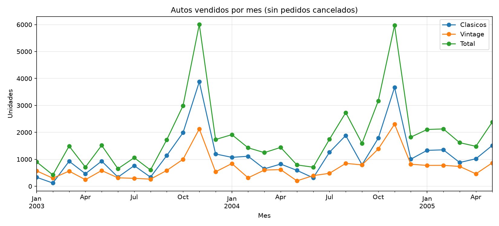
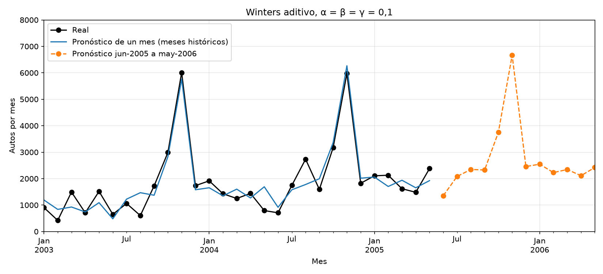
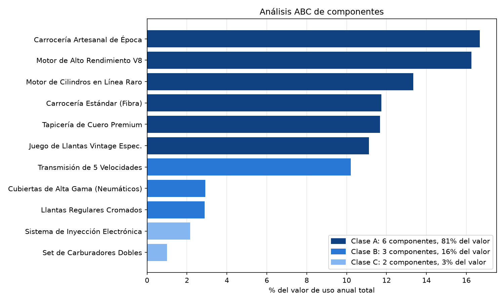

# Resumen Ejecutivo

# Análisis Preliminar

## 1. Serie de demanda

Criterios para armar la serie:

- **Líneas:** solo Classic Cars y Vintage Cars, las dos del caso.
- **Pedidos:** se excluyen solo los cancelados. La demanda es lo que pidió el cliente, se haya despachado o no.
- **Unidad:** un auto es una unidad de `QUANTITYORDERED`, según indicó la cátedra.
- **Período:** mensual, que es la agregación más fina sin períodos sin demanda.

La serie tiene 29 meses, de enero de 2003 a mayo de 2005, y 54.108 autos: 33.499 Clásicos y 20.609 Vintage.

La serie tiene un pico en noviembre de unos 6.000 autos, en los dos años. La tendencia es creciente: 2004 tuvo un 24% más de autos que 2003. La mezcla varía: los Clásicos son el 62% del total, pero mes a mes van del 29% al 78%.

## 2. Pronóstico

Se pronostica la demanda total y se reparte entre las líneas con las proporciones históricas: 61,9% Clásicos y 38,1% Vintage.

**Tabla 1.** Error del pronóstico de un mes, de enero de 2004 a mayo de 2005, con constantes de 0,1.

| Modelo | RMSE (autos) | MAPE |
|---|---:|---:|
| Media móvil, 3 meses | 1.352 | 53,3% |
| Media móvil, 6 meses | 1.436 | 63,3% |
| Media móvil, 12 meses | 1.124 | 39,0% |
| Suavizado exponencial | 1.195 | 38,0% |
| Holt | 1.243 | 60,0% |
| Winters multiplicativo | 400 | 19,3% |
| Winters aditivo | 411 | 21,6% |

Winters erra unas tres veces menos que los otros modelos, porque es el único que tiene en cuenta la estacionalidad.

Se eligió la versión aditiva, en la que el pico es una cantidad fija de autos y no un porcentaje del nivel. Coincide con los datos: el año creció un 24%, pero noviembre se mantuvo (6.009 autos en 2003 y 5.974 en 2004). Además, ajustada solo con 2003 y 2004, la aditiva pronostica mejor enero a mayo de 2005: 8.874 autos, contra 8.402 de la multiplicativa y 9.716 reales.

**Constantes:** el optimizador da α = β = γ = 0, un modelo que no se actualiza con datos nuevos y que la cátedra desaconsejó. Entre 0,1, 0,2 y 0,3, el rango que sugiere la bibliografía, se eligió 0,1 por tener el menor RMSE (401, contra 454 y 515).

**Resultado:** la demanda anual es la suma del pronóstico de junio de 2005 a mayo de 2006. El desvío es el RMSE del error de pronóstico, que estima su desviación estándar. El de cada línea se mide contra la venta real de esa línea.

**Tabla 2.** Demanda anual y desvío del error mensual.

| Línea | Demanda anual (autos) | Desvío mensual (autos) |
|---|---:|---:|
| Clásicos | 20.205 | 320 |
| Vintage | 12.430 | 152 |
| Total | 32.635 | 401 |

## 3. ABC y XYZ

Para cada componente se calculan dos valores:

- **Demanda anual:** la demanda de su línea × uso por auto. Los componentes de las dos líneas usan la demanda total.
- **Valor de uso anual:** la demanda anual × costo unitario.

Clase A agrupa los componentes hasta el 80% del valor acumulado, B hasta el 95% y C el resto. El XYZ usa el coeficiente de variación (CV) de la demanda mensual: X por debajo del 20%, Y entre 20% y 50%, y Z por encima del 50%.

**Tabla 3.** Clasificación ABC y XYZ.

| Componente | Línea | Demanda anual (unidades) | Valor de uso (millones de $) | % acumulado | ABC | CV | XYZ |
|---|---|---:|---:|---:|:---:|---:|:---:|
| Carrocería Artesanal de Época | Vintage | 12.430 | 186,4 | 16,7% | A | 69,6% | Z |
| Motor de Alto Rendimiento V8 | Clásico | 20.205 | 181,8 | 32,9% | A | 75,0% | Z |
| Motor de Cilindros en Línea Raro | Vintage | 12.430 | 149,2 | 46,3% | A | 69,6% | Z |
| Carrocería Estándar (Fibra) | Clásico | 20.205 | 131,3 | 58,0% | A | 75,0% | Z |
| Tapicería de Cuero Premium | Ambas | 32.635 | 130,5 | 69,7% | A | 71,7% | Z |
| Juego de Llantas Vintage Espec. | Vintage | 49.720 | 124,3 | 80,8% | A | 69,6% | Z |
| Transmisión de 5 Velocidades | Ambas | 32.635 | 114,2 | 91,0% | B | 71,7% | Z |
| Cubiertas de Alta Gama (Neumáticos) | Ambas | 130.538 | 32,6 | 93,9% | B | 71,7% | Z |
| Llantas Regulares Cromados | Clásico | 80.818 | 32,3 | 96,8% | B | 75,0% | Z |
| Sistema de Inyección Electrónica | Clásico | 20.205 | 24,2 | 99,0% | C | 75,0% | Z |
| Set de Carburadores Dobles | Vintage | 12.430 | 11,2 | 100,0% | C | 69,6% | Z |

Seis componentes son clase A y juntan el 81% del valor; con un corte de 75%, son los mismos. A ellos se aplican los modelos de inventario.

Todos los componentes son Z, y con el criterio del apunte la demanda es probabilística no estacionaria. Por eso se usan modelos probabilísticos con stock de seguridad. Ese stock se calcula con el error de pronóstico y no con el CV, porque el CV incluye el pico de noviembre, que el pronóstico ya anticipa.

## 4. Parámetros de riesgo

- **Costo de pedido y de mantener:** K = $300 por pedido, y c1 = 20% del costo unitario por año.
- **Costo de agotamiento:** c2 = 5% del precio del auto, que es el descuento al cliente por la demora. El precio de un auto es `SALES / QUANTITYORDERED × 1000`, según indicó la cátedra, en promedio por línea: $115.238 para Clásicos, $90.499 para Vintage y $105.815 para las dos líneas, que se usa para la tapicería. En las llantas vintage se divide por 4, porque el descuento es por auto y cada auto lleva cuatro llantas.
- **Desvío mensual:** el de la línea del componente (Tabla 2) × uso por auto.
- **Demanda durante el lead time:** se supone normal, con E[x] = d · L y σx = σ · √L. La demanda mensual es d = D / 12, y L es el lead time en meses (semanas × 12 / 52).

**Tabla 4.** Parámetros de los componentes clase A (K = $300).

| Componente | D anual | c1 ($/año) | c2 ($) | σ mensual | L (meses) | E[x] | σx |
|---|---:|---:|---:|---:|---:|---:|---:|
| Carrocería Artesanal de Época | 12.430 | 3.000 | 4.525 | 152 | 2,31 | 2.390 | 231 |
| Motor de Alto Rendimiento V8 | 20.205 | 1.800 | 5.762 | 320 | 1,38 | 2.331 | 377 |
| Motor de Cilindros en Línea Raro | 12.430 | 2.400 | 4.525 | 152 | 2,77 | 2.868 | 253 |
| Carrocería Estándar (Fibra) | 20.205 | 1.300 | 5.762 | 320 | 0,92 | 1.554 | 308 |
| Tapicería de Cuero Premium | 32.635 | 800 | 5.291 | 401 | 1,85 | 5.021 | 545 |
| Juego de Llantas Vintage Espec. | 49.720 | 500 | 1.131 | 608 | 1,15 | 4.781 | 653 |

Los seis componentes cumplen la condición q̃ ≥ q̂ de Hadley-Whitin, así que la política óptima por costos tiene solución para todos.

## 5. Limitaciones

- **Pocos datos:** la serie tiene solo 29 meses, con dos noviembres.
- **Posible subestimación:** el modelo se quedó un 9% corto en enero a mayo de 2005, así que la demanda anual puede estar subestimada.
- **Reparto fijo:** la demanda de cada línea sale de proporciones fijas, pero la mezcla varía mes a mes.
- **Supuestos:** la demanda durante el lead time es normal, el error de un mes no depende del de otros meses, y un mes tiene 52/12 semanas.

# Modelos

# Sensibilidad

# Conclusiones
